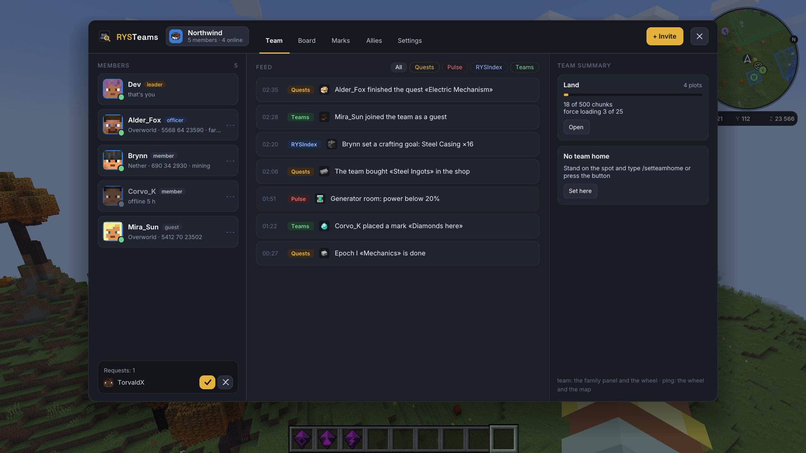

# RYSTeams

*Русская версия ниже: [по-русски](#по-русски).*



**Player teams in one window.** Create a team, invite friends, hand out roles and form an alliance without typing chat commands. Teams from FTB Teams move over with their members, roles and alliances, so nobody has to rebuild them.

## Features

- the Team window with members and an event feed
- invites, join requests and open teams
- four roles and a permissions table
- alliances and team chat: `!text` to your team, `!!text` to your team and allies
- a board with notes and tasks
- marks and pings
- team merging with an undo

## Requirements

- Minecraft 1.21.1, NeoForge 21.1.x, client and server.
- No other mods required.
- Languages: English and Russian.

## Download and help

- Download: [CurseForge](https://www.curseforge.com/minecraft/mc-mods/rysteams).
- Help, ideas and questions: [Discord](https://discord.gg/Tqgy7acmyd).
- Bugs: [GitHub Issues](https://github.com/MityaKr/RYSTeams/issues).

## The RYS family

RYSTeams is part of the RYS family of mods: one style, shared themes and settings. Each mod works on its own, and together they complement each other.

- [RYSQuests](https://www.curseforge.com/minecraft/mc-mods/rysquests), a quest book with guides and a shop.
- [RYSIndex](https://www.curseforge.com/minecraft/mc-mods/rysindex), a recipe viewer with crafting trees.
- [RYSMap](https://www.curseforge.com/minecraft/mc-mods/rysmap), a world map and minimap.
- [RYSClaims](https://www.curseforge.com/minecraft/mc-mods/rysclaims), chunk land claims.
- [RYSHelm](https://www.curseforge.com/minecraft/mc-mods/ryshelm), the Server window for admins.

## Building from source

You need Java 21. The build takes the family's shared code from the [RYSCore](https://github.com/MityaKr/RYSCore) repository, which must sit next to this one and be published to its local `repo/` folder first:

```
git clone https://github.com/MityaKr/RYSCore
git clone https://github.com/MityaKr/RYSTeams
cd RYSCore && ./gradlew publish
cd ../RYSTeams && ./gradlew build
```

The jar is in `build/libs`.

## License

The code is under [MPL-2.0](LICENSE). The graphics and the RYS name remain with the author, see [NOTICE.md](NOTICE.md). You can include the mod in any modpack without asking for permission.

Author: MityaYS, RepkaWorks.

---

## По-русски

**Команды игроков в одном окне.** Создать команду, позвать друзей, раздать роли и заключить союз можно без команд в чате. Команды из FTB Teams переезжают с составом, ролями и союзами: собирать их заново не придётся.

### Возможности

- окно «Команда» с участниками и лентой событий
- приглашения, заявки и открытые команды
- четыре роли и таблица прав
- союзы и чат команды: `!текст` пишет команде, `!!текст` команде и союзникам
- доска с заметками и делами
- метки и пинги
- слияние команд с откатом

### Требования

- Minecraft 1.21.1, NeoForge 21.1.x, клиент и сервер.
- Других модов не требует.
- Языки: русский и английский.

### Скачать и спросить

- Скачать: [CurseForge](https://www.curseforge.com/minecraft/mc-mods/rysteams).
- Помощь, идеи и вопросы: [Discord](https://discord.gg/Tqgy7acmyd).
- Баги: [GitHub Issues](https://github.com/MityaKr/RYSTeams/issues).

### Семья RYS

RYSTeams входит в семью модов RYS: один стиль, общие темы и настройки. Каждый мод работает сам по себе, а вместе они дополняют друг друга.

- [RYSQuests](https://www.curseforge.com/minecraft/mc-mods/rysquests), книга квестов с гайдами и магазином.
- [RYSIndex](https://www.curseforge.com/minecraft/mc-mods/rysindex), справочник рецептов с деревом крафта.
- [RYSMap](https://www.curseforge.com/minecraft/mc-mods/rysmap), карта мира и миникарта.
- [RYSClaims](https://www.curseforge.com/minecraft/mc-mods/rysclaims), приват земли по чанкам.
- [RYSHelm](https://www.curseforge.com/minecraft/mc-mods/ryshelm), окно «Сервер» для администраторов.

### Сборка из исходников

Нужна Java 21. Общий код семьи сборка берёт из репозитория [RYSCore](https://github.com/MityaKr/RYSCore): он должен лежать рядом с этим и сначала выложиться в свою папку `repo/` командой `gradlew publish` (команды выше). Готовый jar лежит в `build/libs`.

### Лицензия

Код под [MPL-2.0](LICENSE), графика и имя RYS остаются за автором, подробности в [NOTICE.md](NOTICE.md). Мод можно включать в любую сборку без отдельного разрешения.

Автор: MityaYS, RepkaWorks.
